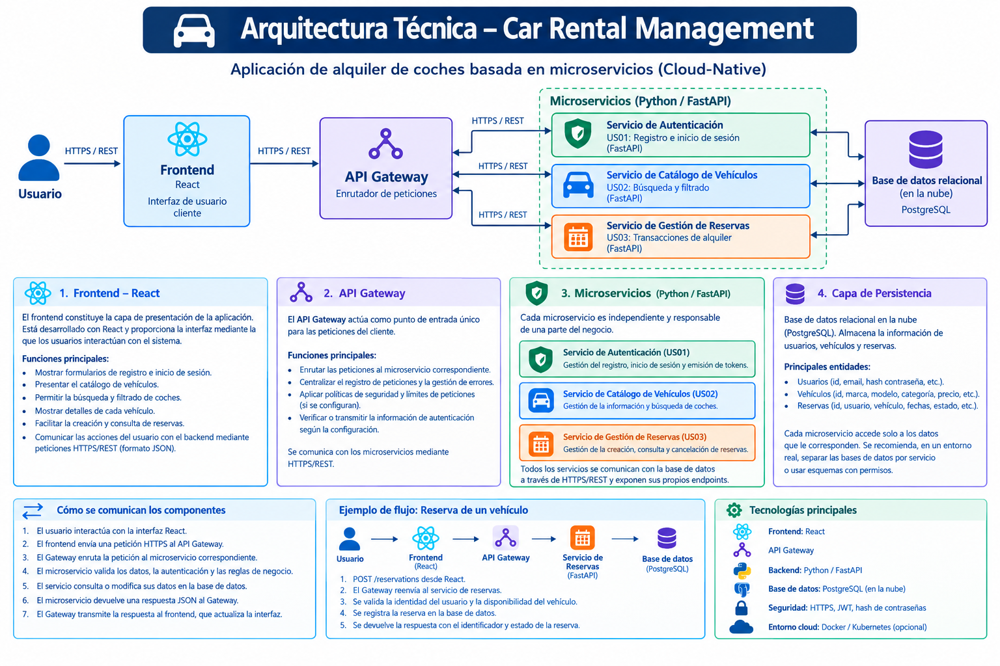

# Car Rental Cloud System — Sistema de Alquiler de Vehículos Cloud Native

Proyecto de la asignatura **Cloud Computing (CC 26-27)** diseñado bajo una arquitectura de microservicios desacoplados, contenerizados e integrados mediante CI/CD.

---

## 1. Arquitectura del Sistema y Evolución (Hito 1 → Hito 2)

En el **Hito 1** se definió la arquitectura lógica del sistema (Frontend React, API Gateway y tres dominios funcionales: Autenticación, Catálogo de Flota y Gestión de Reservas). En el **Hito 2**, esta arquitectura se ha materializado en un entorno **Cloud Native** completo y funcional:

* **Frontend + API Gateway (`frontend`, puerto `5173`)**: Aplicación web SPA desarrollada en **React + Vite**, servida mediante **Nginx no privilegiado** (`nginxinc/nginx-unprivileged:alpine`) que además actúa como *reverse proxy* / API Gateway (`/api/auth/` y `/api/rental/`), evitando problemas de CORS y exponiendo un único punto de entrada.
* **Microservicio de Autenticación (`auth-service`, puerto `8001`)**: Desarrollado en **Python (FastAPI)**. Gestiona el registro de clientes, inicio de sesión, emisión y verificación de tokens **JWT**, control de roles (`customer`, `staff`, `admin`) y bloqueo ante intentos fallidos.
* **Microservicio de Flota, Tarifas y Reservas (`rental-service`, puerto `8002`)**: Desarrollado en **Python (FastAPI)**. Agrupa la gestión de catálogo/flota (`/fleet`, `/pricing`), el motor de reservas (`/reservations`) y el ciclo de alquiler (`/rentals`), comunicándose internamente con `auth-service` mediante clave interna (`INTERNAL_API_KEY`).
* **Capa de Persistencia (`postgres`, puerto `5432`)**: Instancia **PostgreSQL 16 Alpine** bajo el patrón *database-per-service* (`auth_db` y `rental_db` inicializadas automáticamente mediante `infra/postgres/init.sql`).



---

## 2. Entregables del Hito 2: Empaquetado Cloud Native, Orquestación e Integración Continua

### 2.1. Dockerfiles de Producción (`auth-service/Dockerfile`, `rental-service/Dockerfile`, `frontend/Dockerfile`)
* **Construcción multietapa (*Multi-stage builds*)**:
  * En los microservicios Python (`python:3.12-slim`), la etapa `builder` instala las dependencias de `requirements.txt` en `/install` y la etapa `runtime` copia únicamente los binarios compilados junto al código fuente (`app/`), reduciendo el tamaño final y eliminando herramientas innecesarias.
  * En el frontend (`node:24-alpine` → `nginxinc/nginx-unprivileged:alpine`), Node compila el bundle estático de Vite (`npm run build`) y la imagen final solo contiene Nginx y los estáticos generados.
* **Principio de mínimo privilegio (*Non-root*)**:
  * Los servicios Python crean y ejecutan el proceso Uvicorn bajo el usuario sin privilegios `appuser` (`UID 10001`).
  * El contenedor `frontend` utiliza `nginxinc/nginx-unprivileged:alpine` escuchando en el puerto no privilegiado `8080`.
* **Optimización de caché y `.dockerignore`**: Se copian primero los ficheros de manifiesto de dependencias (`requirements.txt` y `package*.json`) antes del código fuente para aprovechar la caché de capas de Docker.

### 2.2. Manifiesto de Orquestación Local (`compose.yaml`)
* **Clúster local reproducible**: Orquesta 4 servicios (`frontend`, `auth-service`, `rental-service` y `postgres`) con `healthcheck` y arranque ordenado (`depends_on: condition: service_healthy`).
* **Redes virtuales aisladas**:
  * `app` (`bridge`): Comunica el frontend/gateway con los microservicios.
  * `data` (`bridge`, `internal: true`): Red interna completamente aislada del exterior para el tráfico entre los microservicios y PostgreSQL.
* **Persistencia mediante volúmenes**: Volumen gestionado `pgdata` montado en `/var/lib/postgresql/data` para garantizar la durabilidad de los datos entre reinicios.
* **Variables de entorno (`.env.example`)**: Plantilla de configuración sin credenciales reales.

### 2.3. Integración Continua y Registro de Contenedores (`.github/workflows/ci.yml`)
El pipeline de GitHub Actions se dispara automáticamente ante `push` y `pull_request` sobre la rama `main`:
1. **Linters de código y Dockerfiles**: Ejecuta **Ruff** sobre el código Python (`app/` y `tests/`), **Hadolint** sobre todos los `Dockerfile` y `docker compose -f compose.yaml config` para validar el manifiesto.
2. **Pruebas automatizadas (`pytest`)**: Ejecuta pruebas unitarias y de integración en `auth-service/tests/` y `rental-service/tests/`.
3. **Publicación en GitHub Container Registry (`ghcr.io`)**: En cada `push` a `main`, construye las 3 imágenes de producción y las publica en `ghcr.io/<usuario>/car-rental-<servicio>` etiquetadas con el hash del commit (`sha-<commit>`) y `latest`.

---

## 3. Guía de Ejecución Local

1. **Preparar las variables de entorno**:
   ```bash
   cp .env.example .env
   ```
2. **Levantar todo el sistema con un único comando**:
   ```bash
   docker compose up -d --build
   ```
3. **Comprobar el estado de los contenedores**:
   ```bash
   docker compose ps
   ```
4. **Acceder a la aplicación**:
   * **Frontend Web (React)**: `http://localhost:5173`
   * **Documentación Swagger `auth-service`**: `http://localhost:8001/docs`
   * **Documentación Swagger `rental-service`**: `http://localhost:8002/docs`
   * **Credenciales de administrador por defecto**: revisa `Usuario_Administrador.txt` (`admin@carrental.local` / `Admin1234!`).
5. **Detener el entorno conservando la base de datos**:
   ```bash
   docker compose down
   ```
