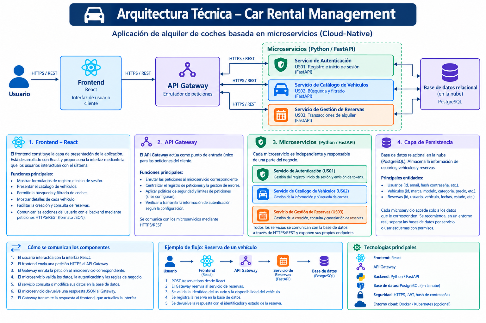

# car-rental-cloud
Car Rental Cloud Platform - Proyecto Cloud Computing UGR.
# Car Rental Management System

## 1. Descripción del proyecto
Car Rental Management System es una aplicación web para la gestión del alquiler de vehículos, diseñada siguiendo una arquitectura basada en microservicios y principios Cloud-Native.
El sistema permite a los usuarios registrarse, iniciar sesión, consultar el catálogo de vehículos disponibles y realizar reservas de alquiler.
La aplicación está organizada en componentes independientes que facilitan el mantenimiento, la escalabilidad y la evolución del sistema.

## 2. Arquitectura general
La arquitectura está compuesta por los siguientes elementos:
- **Frontend:** React, encargado de la interfaz de usuario.
- **API Gateway:** Punto de entrada único para las peticiones del cliente.
- **Microservicio de Autenticación:** Desarrollado con Python y FastAPI.
- **Microservicio de Catálogo de Vehículos:** Developed con Python y FastAPI.
- **Microservicio de Gestión de Reservas:** Desarrollado con Python y FastAPI.
- **Base de datos relacional:** Almacenamiento persistente de usuarios, vehículos y reservas (PostgreSQL).

## 3. Descripción de los componentes

### 3.1. Frontend: React
El frontend constituye la capa de presentación de la aplicación. Está desarrollado con React y proporciona la interfaz mediante la que los usuarios interactúan con el sistema.
Sus principales responsabilidades son:
- Mostrar los formularios de registro e inicio de sesión.
- Presentar el catálogo de vehículos disponibles.
- Permitir la búsqueda y el filtrado de coches.
- Mostrar los detalles de cada vehículo.
- Facilitar la creación y consulta de reservas.
- Comunicar las acciones del usuario con el backend mediante peticiones HTTP.

### 3.2. API Gateway
El API Gateway actúa como punto de entrada único para las peticiones procedentes del frontend.
Sus responsabilidades principales son:
- Enrutar las peticiones al microservicio correspondiente.
- Centralizar aspectos comunes de la comunicación, como el registro de peticiones y la gestión de errores.
- Aplicar políticas de seguridad y límites de peticiones cuando estén configurados.
- Verificar o transmitir la información de autenticación según la configuración del sistema.

### 3.3. Microservicio de Autenticación (US01)
Este servicio está desarrollado con Python y FastAPI y se encarga de gestionar la identidad y el acceso de los usuarios.
Funcionalidades principales:
- Registrar nuevos usuarios.
- Validar las credenciales durante el inicio de sesión.
- Almacenar las contraseñas utilizando mecanismos de hash seguros.
- Emitir tokens de acceso, por ejemplo, mediante JWT.
- Validar la identidad del usuario en las operaciones protegidas.

### 3.4. Microservicio de Catálogo de Vehículos (US02)
Este servicio gestiona la información de los coches disponibles para alquiler y permite consultar el catálogo aplicando diferentes criterios de búsqueda.
Funcionalidades principales:
- Consultar los vehículos registrados.
- Buscar vehículos por marca o modelo.
- Filtrar por precio, categoría u otras características.
- Consultar la información detallada de un vehículo.

### 3.5. Microservicio de Gestión de Reservas (US03)
Este servicio gestiona el proceso de alquiler y las reservas realizadas por los usuarios.
Funcionalidades principales:
- Crear una reserva de alquiler.
- Consultar las reservas de un usuario.
- Cancelar reservas cuando las reglas del negocio lo permitan.
- Comprobar la disponibilidad del vehículo para el intervalo solicitado, evitando dobles reservas.

## 4. Capa de persistencia
La aplicación utiliza una base de datos relacional alojada en un entorno cloud (PostgreSQL como servicio gestionado).
La persistencia almacena los datos necesarios:
- **Usuarios:** identificador, correo electrónico, hash de contraseña y perfil.
- **Vehículos:** identificador, marca, modelo, categoría, precio y estado.
- **Reservas:** identificador, usuario, vehículo, fechas y estado del alquiler.

## 5. Diagrama de Arquitectura

El siguiente diagrama detalla la arquitectura nativa de la nube (*Cloud-Native*) de la aplicación, mostrando los componentes de frontend, la API Gateway, los microservicios en Python y la base de datos persistente:

### Comunicación entre componentes
La comunicación entre el frontend y el backend se realiza mediante **HTTPS y una API REST** en formato JSON.
*Ejemplo de flujo de reserva:*
1. El usuario realiza una acción desde la interfaz React.
2. El frontend envía una petición HTTPS al API Gateway.
3. El Gateway reenvía la petición al microservicio de reservas.
4. El servicio valida los datos, la autenticación y comprueba la disponibilidad del vehículo.
5. Se registra la reserva en la base de datos y se devuelve la respuesta al frontend.

## 6. Seguridad y Consideraciones Cloud-Native
- **Seguridad:** Uso de HTTPS, autenticación basada en tokens, contraseñas cifradas con hash y validación de datos.
- **Cloud-Native:** Preparado para contenerización mediante Docker, configuración externa y escalado independiente de los servicios.
